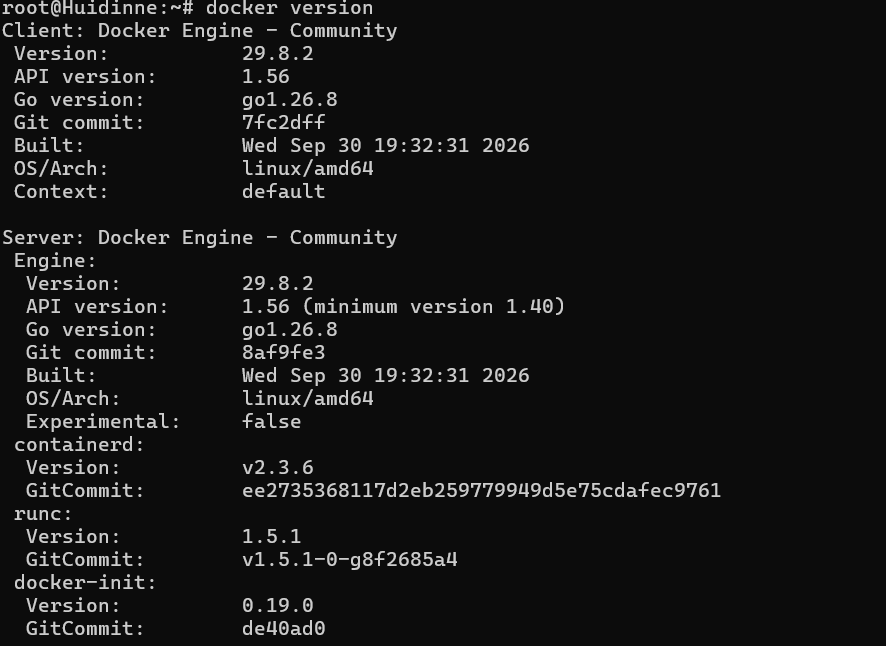
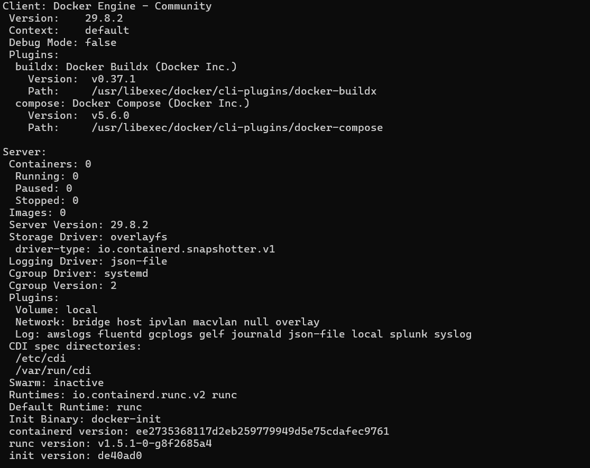
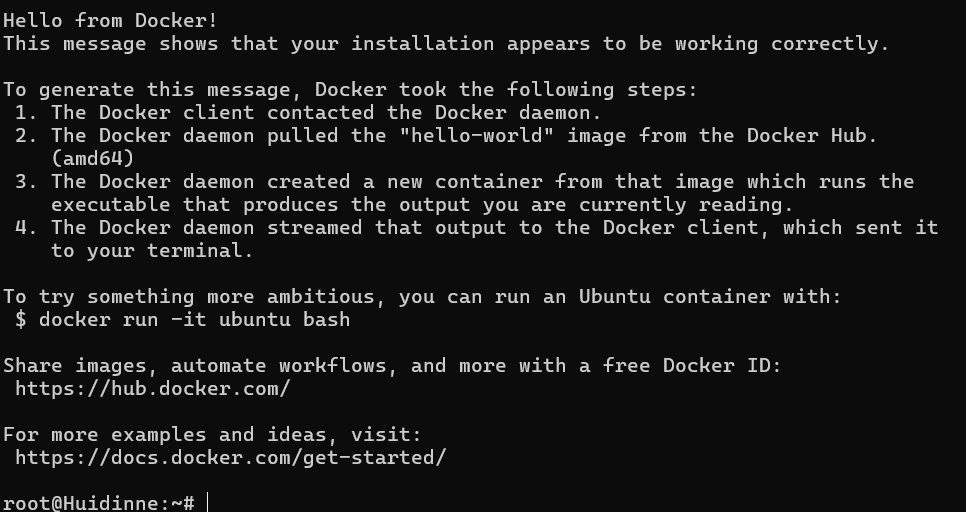

# Báo Cáo Thực Hành: Kiểm Tra Cài Đặt Docker Engine và Chạy Container Hello-World

## 1. Kiểm tra phiên bản Docker (`docker version`)

Lệnh thực thi:
```bash
docker version
```

Kết quả đầu ra:



---

## 2. Kiểm tra thông tin hệ thống Docker (`docker info`)

Lệnh thực thi:
```bash
docker info
```

Kết quả đầu ra:


---

## 3. Khởi chạy container đầu tiên (`docker run hello-world`)

Lệnh thực thi:
```bash
docker run hello-world
```

Kết quả đầu ra:


---

## 4. Kết luận

- Docker CLI và Docker Daemon đã được cài đặt và kết nối thành công mà không cần quyền `sudo`.
- Container `hello-world` đã tải image thành công từ Docker Hub và hiển thị thông điệp xác nhận cài đặt hoàn tất.
